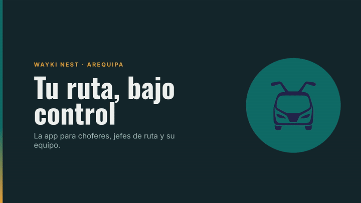
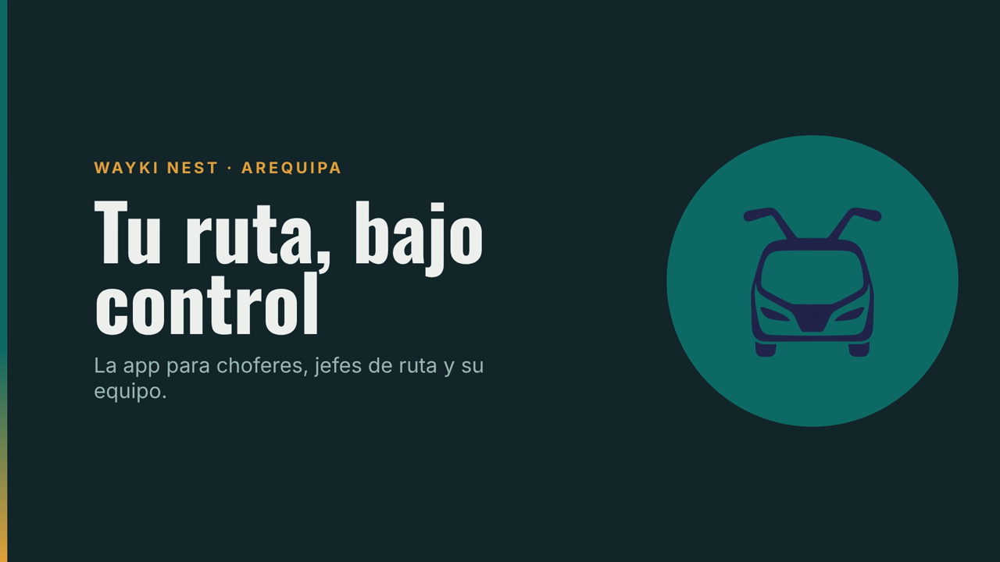
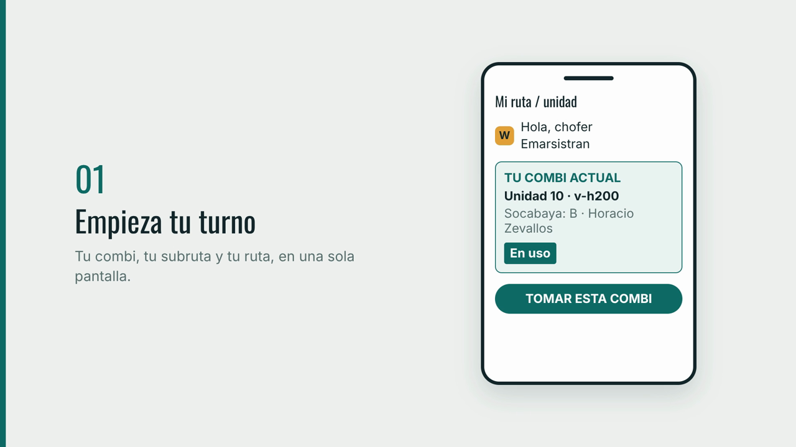
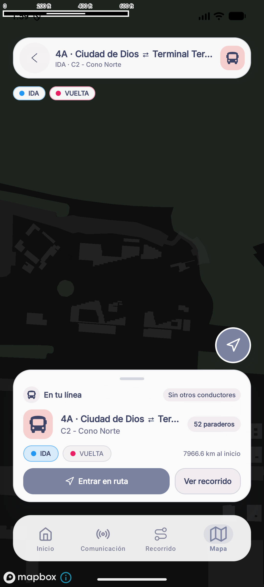
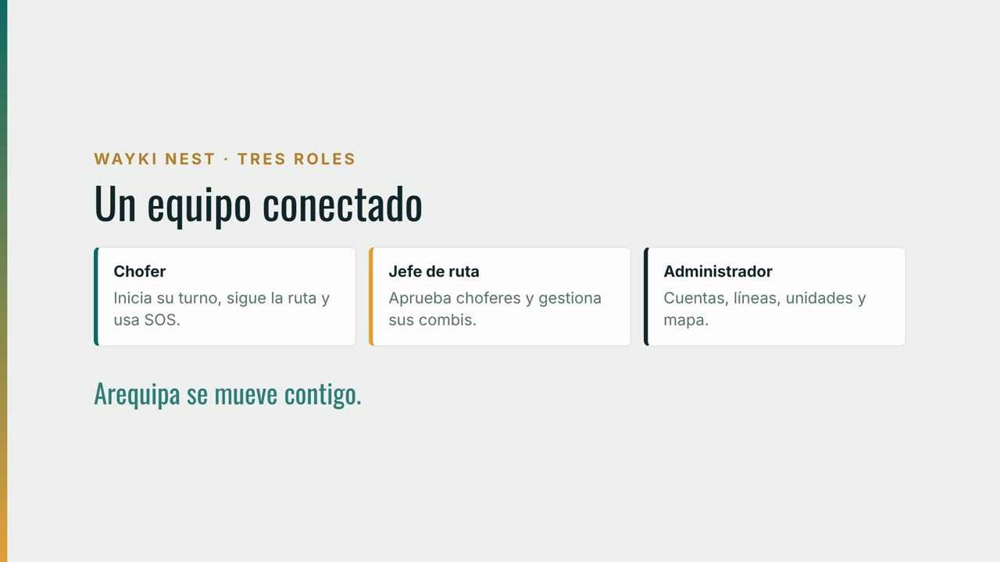

# Wayki Nest

App de movilidad para choferes, jefes de ruta y administración: turno, rutas y subrutas,
mapa en vivo, chat por subruta y un botón de SOS con hardware BLE. Está hecha en
**Kotlin Multiplatform** con **Compose Multiplatform**: la lógica y la interfaz viven en
`shared`, y Android e iOS son solo contenedores del mismo código.

## Vista rápida



<table>
  <tr>
    <td width="50%"></td>
    <td width="50%"></td>
  </tr>
  <tr>
    <td></td>
    <td></td>
  </tr>
</table>

## Qué incluye la app

| Área | Qué hace |
| --- | --- |
| **Acceso** | Login con DNI y PIN, bloqueo por intentos fallidos (estado `423`), recuperación de acceso, registro y cambio de PIN desde la app. Los mensajes de error vienen del backend y nunca muestran IPs ni detalles técnicos. |
| **Turno y ruta** | Elección de línea y unidad, puntos de control del día, horarios programados, porcentaje de cumplimiento, avisos de almuerzo y de combis adelantadas o atrasadas. |
| **Mapa y subrutas** | Trazado de la ruta, paraderos, subrutas, ubicación GPS del teléfono, distancias y tiempos al inicio del recorrido, con solicitudes de cambio de ruta y catálogo actualizable. |
| **Comunicación** | Chat de texto y notas de voz, grupos por ruta y subruta, contador de no leídos, limpiar chat solo para uno y eliminación de grupos con borrado diferido de 72 horas. |
| **SOS** | Botón físico ESP32 por Bluetooth, GPS con precisión y zona de referencia, emergencias cercanas y activas, y puntos marcados en el mapa; también graba audio y pantalla. |
| **Perfil y ajustes** | Subruta asignada, línea y combi del turno, alertas de tiempo y de puntos de control, avisos discretos, búsqueda del ESP32 y atribución de datos geográficos. |

## Arquitectura

```text
androidApp/   contenedor Android: permisos, entry point, firma y google-services.json
iosApp/       contenedor iOS
shared/       código común (Kotlin + Compose)
  commonMain/kotlin/com/gowayki/nesh/
    app/features/     pantallas por funcionalidad: sign_in, home, map,
                      communication, sos, reports, route_detail, settings, profile…
    app/navigation/   Routes (rutas tipadas) y WaykiNav
    app/di/           inyección manual: AppDi, AuthDi, ChatDi
    domain/           modelos y puertos del dominio
    data/             adaptadores Ktor/Supabase y tiendas locales
    core/             tema, configuración generada, MQTT, red y sesión
  androidMain/        implementaciones y recursos de Android
  iosMain/            implementaciones de iOS
  commonTest/         tests de la lógica compartida
```

- **Navegación tipada**: `Routes` evita strings sueltos; `chat/{conversationId}` exige su
  argumento y se construye con `Routes.chat(id)`.
- **Capas**: `presentation` → `domain` → `data/infra`. Las pantallas no hablan con Ktor
  directamente; pasan por repositorios y casos de uso.
- **Configuración generada**: `core/config/AppConfig.kt` se genera en cada build desde
  `.env` (o desde variables de entorno en CI). No se edita a mano ni se versiona.
- **Backend**: la API Spring Boot en `/api` cubre autenticación, rutas, paraderos,
  geometría, chat, turnos y SOS. Las altas y los cambios de ruta se envían como
  solicitudes que luego aprueba el panel Django.
- **Interruptor de beta**: `BetaFlags.selfAssignRoutes = true` permite que el chofer
  elija línea y unidad; pasa a `false` cuando la asignación la gestione la empresa.

## Requisitos

- **JDK 17**.
- **Android SDK** (compileSdk y targetSdk 37, minSdk 24; ver `gradle/libs.versions.toml`).
- **Node.js 20+** para convertir iconos SVG a XML de Android.
- **Token de descarga de Mapbox** en `~/.gradle/gradle.properties`:
  `MAPBOX_DOWNLOADS_TOKEN=sk.…` (se usa para resolver el SDK; nunca se commitea).
- **`gh` autenticado** solo si vas a publicar una beta desde tu máquina.

## Configuración local

Crea un `.env` en la raíz con estas claves:

```dotenv
BACKEND_URL=http://31.220.72.2:8080/api
SUPABASE_URL=…
SUPABASE_ANON_KEY=…
GOOGLE_WEB_CLIENT_ID=…
```

El script de Gradle `generateAppConfig` inyecta esos valores en `AppConfig.kt`. Tanto
`.env` como `AppConfig.kt` están en `.gitignore`: **no se suben al repo**. El mismo
mecanismo acepta variables de entorno (`BACKEND_URL`, `SUPABASE_URL`,
`SUPABASE_ANON_KEY`, `GOOGLE_WEB_CLIENT_ID`) o propiedades Gradle
(`wayki.backend.url`, etc.); en CI se usan los secretos del repo.

El canal beta permite `http://` de forma explícita:
`wayki.backend.allowHttp=true` en `gradle.properties` y `BACKEND_ALLOW_HTTP=1` como
variable **no secreta** del repo. Sin esa señal el build rechaza `http://` porque el
login envía DNI y PIN (CWE-319).

## Compilar, ejecutar y probar

```bash
# Lógica compartida (11 tests)
./gradlew :shared:testAndroidHostTest

# APK de depuración e instalación en dispositivo/emulador
./gradlew :androidApp:assembleDebug
./gradlew :androidApp:installDebug

# Iconos SVG → XML (también se ejecuta automáticamente al compilar)
./gradlew :shared:convertSvgIcons
```

En Linux los targets de iOS no se compilan: `gradle.properties` ya incluye
`kotlin.native.ignoreDisabledTargets=true`.

## Descargar el APK (Android)

[**Descargar la última beta**](https://github.com/laplace71/gowayki-nest/releases/download/beta/wayki-nest-beta.apk)
· [todas las releases](https://github.com/laplace71/gowayki-nest/releases)

El APK se compila, firma y publica solo: cada push a `main` reemplaza el asset
`wayki-nest-beta.apk` de la release `beta` (la URL de descarga nunca cambia).
El pipeline está en [`.github/workflows/apk.yml`](.github/workflows/apk.yml) y
también se puede lanzar a mano desde *Actions > APK beta > Run workflow*.
Para publicar sin esperar al CI: `./scripts/publicar-apk.sh`.

Los tags `v*` generan una release propia (`v1.0.0`, `v1.1.0`, …). Los `.apk`
nunca se commitean al repo: GitHub rechaza archivos de más de 100 MB.

Las notas de la release se generan solas: changelog desde la beta anterior
(commits de `main`), instrucciones de instalación y una tabla verificable con
versión, `versionCode`, tamaño, commit, SHA-256 del APK y huella SHA-256 del
certificado.

### Quién puede publicar

Cualquier colaborador con permiso de escritura en el repo, sin configurar nada:

- **Merge a `main`** (o push directo): el CI publica solo. No hace falta que tu
  máquina esté encendida; usa el `GITHUB_TOKEN` del repo.
- **A mano**: *Actions > APK beta > Run workflow*, eligiendo la rama. Ojo:
  publica el código de esa rama tal cual, aunque no esté mergeado.
- **Desde local**: `./scripts/publicar-apk.sh` (requiere `gh` autenticado, el
  SDK de Android y los secretos de firma exportados).

Todas las publicaciones que van a `beta` comparten el mismo grupo de
`concurrency`: **no se cancela** la que ya está corriendo (una subida a medias
dejaría notas y APK describiendo versiones distintas); los demás runs esperan,
y GitHub puede descartar uno que aún está en espera si llega uno más nuevo.
Además, CI y publicación local toman un **lock exclusivo** en el repo de
destino antes de compilar y comprueban que siguen siendo dueños justo antes de
subir ([`scripts/release-state.sh`](scripts/release-state.sh)). El lock usa la
API de GitHub con `GH_TOKEN`, así que sirve igual en clones HTTPS, forks y
worktrees, y nunca publica commits sin subir. **No caduca por tiempo**: si el
publicador original murió, confirma que paró y ejecuta
`WAYKI_FORCE_UNLOCK=1 scripts/release-state.sh lock-recover`. La recuperación no
cancela una escritura que ya superó su `lock-check`: antes de usarla, asegúrate
de que el publicador original se detuvo por completo (no basta con matar el
proceso a medias). Cada `upload`/`edit`/`create` y el movimiento del tag
re-verifican la propiedad del lock inmediatamente antes de escribir.

El `versionCode` sale de **una sola secuencia monotónica** compartida por CI y
publicación local: se siembra con el tiempo Unix y nunca baja del último código
publicado + 1, así ninguna beta puede degenerar en un downgrade que Android
rechace.

### Firma y configuración

Para que Android instale una beta encima de la anterior, todas deben estar
firmadas con la **misma clave privada**. Esa clave no está en el repo: un
keystore cuyo privado puede leer cualquiera con acceso de lectura permitiría
falsificar una "beta oficial" y Android no podría distinguirla (CWE-321).
Se configura una vez como secretos del repo y se exportan con los mismos
nombres desde local:

1. `RELEASE_KEYSTORE_BASE64`, `RELEASE_KEYSTORE_PASSWORD`,
   `RELEASE_KEY_ALIAS`, `RELEASE_KEY_PASSWORD` — clave de firma.
2. `BACKEND_URL` — URL del backend. Lo normal es `https://`: el inicio de
   sesión envía DNI y PIN y el build rechaza `http://` (CWE-319).
3. `BACKEND_ALLOW_HTTP` — variable **no secreta** del repo (no un secret).
   Hoy el backend de la beta es la IP `31.220.72.2` sin TLS, así que está
   puesta a `1` como opt-in temporal y asumido: con ese valor se permite
   `http://` y las notas avisan de que el tráfico va sin cifrar. Poniéndola a
   `0` se vuelve a exigir HTTPS; cuando el backend tenga TLS, configura
   `BACKEND_URL` con la URL `https://` y borra la variable.

Si falta la clave de firma, el CI **falla** en lugar de caer en un keystore
público o temporal. Antes de subir el APK se comprueba que su `versionCode` es
mayor que el de la beta publicada y que su huella de certificado coincide; si
no, la publicación se aborta.

> Si instalaste una beta antigua firmada con el keystore público que estaba en
> el repo, desinstálala una vez e instala la nueva: el cambio a una clave
> privada es irreversible para esa instalación. Es el coste único de que una
> beta falsificada ya no pueda suplantar a la oficial.

## Iconos (SVG → XML)

1. Coloca el `.svg` en `shared/src/commonMain/iconsSvg/`
2. Corre `./gradlew :shared:convertSvgIcons` (también corre solo al build)
3. Usa el recurso: `painterResource(Res.drawable.nombre_archivo)`

Salida: `shared/src/commonMain/composeResources/drawable/*.xml`  
Requisito: Node.js (`npx svg2vectordrawable`).

## Solución de problemas

- **El build no resuelve Mapbox**: falta `MAPBOX_DOWNLOADS_TOKEN` en
  `~/.gradle/gradle.properties`. Es un token de descarga del SDK, no un secreto
  de la app.
- **El login falla con `http://`**: el build exige HTTPS. Para la beta actual,
  activa `wayki.backend.allowHttp=true` en local o `BACKEND_ALLOW_HTTP=1` en el
  repo; el tráfico va sin cifrar y las notas de la release lo advierten.
- **Android no instala la beta encima de la anterior**: vienes del keystore
  público antiguo. Desinstala y vuelve a instalar una vez.
- **Un run de APK se quedó colgado**: confirma que el publicador original paró
  y ejecuta `WAYKI_FORCE_UNLOCK=1 scripts/release-state.sh lock-recover`.
- **No aparece la subruta del jefe**: se resuelve desde `usuario_linea` en el
  login; el panel debe asignarla desde *Cuentas* y el jefe debe iniciar sesión
  de nuevo para refrescar el token.
